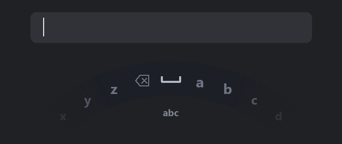

# Controller Keyboard

Use a game controller as a mouse **and a keyboard** on Windows. Hold a button, spin the joystick around a scroll wheel of letters, and press A to type.



It's built for the **8BitDo 64** (the N64-style Bluetooth controller), and other controllers can be mapped in a settings file. It's handy for a couch PC, a media center, or anywhere a real keyboard is out of reach.

## Features

- **Two modes.** In controller mode the app does nothing, so games see a normal controller. The Home button switches to desktop mode, where the controller drives the mouse and keyboard.
- **Scroll-wheel typing.** Letters ride the top arc of a wheel. Tilt the joystick and turn it: each eighth of a turn steps one character. Press A to type it.
- **Three wheels:** letters, numbers and symbols. Each one also has space and backspace.
- **Shift and Caps Lock**, Enter, arrow keys and key repeat.
- **An overlay that stays out of the way.** It's see-through and click-through, can never take focus from the window you're typing in, and only appears while you're typing.
- **A tray icon and a settings window.** The tray icon shows the mode. Sliders adjust speeds and thresholds, and a setup wizard maps any controller: press each control when asked.
- **No install beyond Python.** Two small scripts and three dependencies.

## Requirements

- Windows 10 or 11
- Python 3.10 or newer
- A controller that Windows sees as a game controller. The default layout is the 8BitDo 64 in its 8BitDo Bluetooth mode. Other controllers need a quick mapping (see [Other controllers](#other-controllers)).

## Install and run

```powershell
git clone https://github.com/JosiahGibbs/controller-keyboard.git
cd controller-keyboard
py -m venv .venv
.venv\Scripts\pip install -r requirements.txt
.venv\Scripts\pythonw controller_keyboard.pyw
```

`pythonw` runs it without a console window. The first time, the settings window opens so you can check the controller layout. After that, the app sits in the tray and starts in **controller mode**; press the Home button to switch to desktop mode. To see log messages in a console while trying it out, run `.venv\Scripts\python controller_keyboard.pyw --debug` instead.

**Start at login:** tick **Start at login** in the tray menu, or "Start Controller Keyboard when I sign in" in the settings window. Either one adds a shortcut to your Startup folder.

Only one copy runs at a time. Starting it again opens the settings window of the copy that's already running.

## Tray icon and settings

The tray icon is **blue** in desktop mode, **gray** in controller mode, and an **outline** when no controller is connected. Its menu has:

- **Desktop mode**, to switch modes without the controller;
- **Settings…**, which double-clicking the icon also opens;
- **Start at login**;
- **Quit**.

The settings window has two tabs:

- **General:** sliders for mouse speed and precision, the joystick thresholds, step sensitivity, scroll speed, and the wheel's size and opacity. Changes apply right away, and moving a wheel slider shows the wheel.
- **Controller:** every control with the input it uses. A control lights up in the list when you press it, which makes it easy to spot one that's wrong.
  - **Set up all…** walks through every control: press each one when asked.
  - **Change selected…** redoes just one control.
  - **Auto-detect** fills in the layout for controllers that SDL's controller database knows, such as Xbox and PlayStation pads.
  - **Reset to 8BitDo 64** puts back the defaults.

`controller_keyboard.pyw --settings controller` opens the settings window on the Controller tab.

## Controls

The button names are the 8BitDo 64's.

### Desktop mode

| Control | Does |
|---|---|
| Joystick | Mouse cursor |
| C buttons | Scroll (up, down, left, right) |
| A | Left click (hold to drag) |
| Z (tap) | Right click |
| B | Escape |
| Start | Windows key (Start menu) |
| L / R | Browser Back / Forward |
| D-pad | Arrow keys |
| Home | Switch to controller mode |

### Typing (hold Z)

| Control | Does |
|---|---|
| Tilt the joystick, then turn it | Step through the wheel, one character per eighth of a turn (clockwise = forward) |
| A, while tilted | Type the highlighted character (on ⌫, delete; hold to repeat) |
| A, with the joystick centered | Space |
| B | Backspace (hold to repeat) |
| Press the joystick in | Next wheel: letters → numbers → symbols |
| C-down | Enter |
| Start | Shift for the next letter. Double press for Caps Lock; any press turns Caps Lock off |
| D-pad | Arrow keys |

The wheel rests on the space. Clockwise from there is `a b c …`, and counterclockwise is backspace, then `z y x …`. Letting go of the joystick spins it back to the space. Each new Z press starts on the letters wheel.

## Settings

The settings window covers everything below. Behind it, `settings.json` is created next to the script the first time the app runs, and hand edits are picked up while the app is running.

| Setting | Default | Meaning |
|---|---|---|
| `mouse_max_speed` | 1500 | Cursor speed at full tilt, in pixels per second |
| `mouse_curve` | 2.0 | Higher values give finer control near the center |
| `stick_deadzone` | 0.15 | Joystick movement ignored around the center |
| `aim_threshold` | 0.55 | How far to tilt before the wheel starts turning |
| `release_threshold` | 0.30 | Below this the joystick counts as let go |
| `step_deadband_degrees` | 8 | How far past a boundary to turn before the wheel steps (stops flicker) |
| `scroll_repeat_per_sec` | 12 | Scroll speed while a C button is held |
| `overlay_scale` | 1.0 | Size of the wheel |
| `overlay_opacity` | 0.9 | Opacity of the wheel |
| `controller` | 8BitDo 64 | Which button, axis or D-pad direction each control is |

## Other controllers

The easiest way is the **Controller** tab in the settings window: try **Auto-detect**, then **Set up all…** for anything it gets wrong. The rest of this section is for editing `settings.json` by hand.

Each control in the `controller` section can be one of these:

- a **button number**, such as `8`;
- an **axis direction**, such as `"a4+"` (axis 4 past +0.5) or `"a4-"`. Triggers that rest at -1, as on many Xbox-style pads, use `+`;
- a **D-pad direction**, such as `"h0:up"`.

`stick_x` and `stick_y` are the axis numbers of the stick that moves the mouse and turns the wheel.

To find your controller's numbers, run the helper and press each control:

```powershell
.venv\Scripts\python find_inputs.py
```

It prints the entry to use for each one, such as `axis 4 +  ->  "a4+"`. Copy them into `settings.json`, for example:

```json
"controller": {
    "z": "a4+",
    "c_up": "a3-", "c_down": "a3+", "c_left": "a2-", "c_right": "a2+"
}
```

Any control you leave out keeps its 8BitDo 64 default. On a typical pad, a trigger makes a good Z, and the right stick makes good C buttons.

## Known limits

- **Windows only.** Input is sent with Windows `SendInput`, and the overlay is a Windows layered window.
- **Windows run as administrator** (an elevated Task Manager, for example) don't accept input from a normal app. Windows blocks it.
- **Some games** ignore typed Unicode characters. Switch to controller mode for games anyway.
- **Don't run it alongside another mapper** such as AntiMicroX, or Steam Input in desktop mode, or both will act on the same buttons.
- **In desktop mode, games and browsers still see the controller.** Switch to controller mode before playing.

## License

MIT. See [LICENSE](LICENSE). Provided as-is. Issues and pull requests are welcome, but there's no promise of support.
